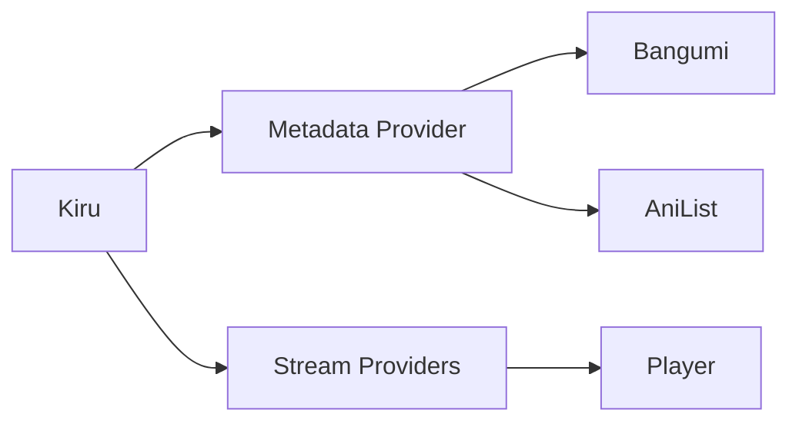

<div align="center">


<h1>Kiru</h1>

<p><code>ANIME / CINEMA / MUSIC / BEYOND</code></p>

<p><strong>连接次元，探索光影。</strong><br/>
<sub>物語の続きを、ここから。 — Your next story begins here.</sub></p>

<a href="LICENSE"></a>


<p><a href="#功能">功能</a> · <a href="#数据源">数据源</a> · <a href="#技术架构">技术架构</a> · <a href="#运行">运行</a> · <a href="#鸣谢">鸣谢</a></p>

</div>

---

**Kiru** 是一款基于 Flutter 的开源、本地优先多媒体客户端，面向中文影音爱好者，将番剧、影视、音乐、阅读与直播融入同一个数字空间。

无需注册 Kiru 账户，收藏、偏好与播放进度保存在设备上。按需连接第三方服务，在属于自己的节奏里继续每一段故事。

## 功能

<sub>01 / FEATURES</sub>

| 模块 | 核心能力 |
| :--- | :--- |
| 🌸 **Anime · 动漫** | Bangumi / AniList 切换、中文片名与简介、季度番剧、题材筛选、搜索及分集信息 |
| 🎬 **Cinema · 影视** | 电影与剧集、精选系列合集、年代片单、季集选择、Stremio 兼容插件与多源播放 |
| 🎧 **Music · 音乐** | 搜索、艺人、专辑、歌单、收藏、音质切换及常驻迷你播放器 |
| 📖 **Reading · 阅读** | 漫画横向或纵向阅读、缩放、章节与页码续读；电子书与有声书、倍速及睡眠定时 |
| 📡 **Live · 直播** | IPTV / Xtream 风格服务、M3U 播放列表、频道搜索与收藏 |
| ◈ **Library · 媒体库** | 片单、观看历史、续播、阅读与收听进度；可选 Trakt / Simkl 同步 |

### ✦ 观影体验 / PLAYBACK

- **双播放内核**：media_kit / libmpv，以及 Android Media3 / ExoPlayer；支持硬件解码、HLS / DASH、字幕样式和多音轨。
- **画质增强**：Anime4K 与 FSR 超分辨率；4K / HDR 播放表现取决于片源、设备和解码器。
- **精选合集**：12 个经典电影系列与 6 类 90 年代片单，可通过用户自行配置的 TMDB API 密钥获取按投票数排序的片单。
- **多源聚合**：启用的来源并发查询，结果逐步展示；支持调整来源优先级、启用或停用来源。

### ✦ 中文体验 / LOCALIZATION

基于 Flutter ARB 国际化体系，支持简体中文、英文与阿拉伯语。中文作品信息优先采用真实元数据，保留原始作品标识及播放匹配参数；无中文信息时回退原文。部分第三方内容及继承模块仍需进一步验收。

## 数据源

<sub>02 / MODULAR SOURCES</sub>



| 来源 | 用途 |
| :--- | :--- |
| [Bangumi](https://bgm.tv/) | 中文番剧名称、简介、标签、评分、搜索及分集标题 |
| [AniList](https://anilist.co/) | 动漫目录、补充信息及现有作品身份兼容 |
| [bangumi-data](https://github.com/bangumi-data/bangumi-data) | 离线中文名称与跨来源 ID 对照 |
| [TMDB](https://www.themoviedb.org/) / Cinemeta | 影视元数据、海报与目录 |
| Stremio-compatible Addons | 可配置的媒体目录与播放源 |

在 **设置 → 内容 → 动漫数据源** 中切换 Bangumi / AniList，支持缓存、自动回退、自定义 HTTPS 镜像及 HTTP 代理，并兼容 Windows 系统代理。元数据与播放源独立管理。

现阶段 Bangumi 目录仅展示可靠映射至 AniList ID 的作品；新增元数据提供方可实现 `AnimeMetadataProvider` 接口。原有播放源则由独立的来源管理与聚合层处理。

[动漫数据源实现说明 →](docs/product-development/ANIME_DATA_SOURCES.md)

## 技术架构

<sub>03 / TECHNOLOGY</sub>

| 模块 | 实现 |
| :--- | :--- |
| Client | Flutter / Dart，统一跨平台客户端 |
| Player | media_kit / libmpv · Media3 / ExoPlayer |
| Source | 模块化元数据接口 · Stremio 插件协议 · HTTP / P2P（TorrServer） |
| UI | Flutter Widgets · Liquid Glass · ARB 国际化 |
| Storage | SharedPreferences · 平台安全存储 |
| Performance | 有界缓存 · 后台刷新 · 并发请求 · 来源故障隔离 |

本地文档采用带校验和及最近可用副本的存储机制。凭据优先使用平台安全存储（不可用时可能回退为明文存储）；诊断报告保存在本地，配置导出默认隐藏敏感信息，并继承上游的加密导出能力。

<details>
<summary><strong>核心工程结构 / PROJECT STRUCTURE</strong></summary>

```text
lib/
├── l10n/              # 国际化与中文展示适配
├── models/            # 媒体与业务数据模型
├── pages/             # 功能页面
├── services/
│   ├── anime/         # 动漫数据源与统一调度
│   ├── metadata/      # 元数据与身份映射
│   ├── addon/         # 插件管理
│   ├── stream/        # 播放源聚合
│   ├── scraper/       # 来源适配
│   ├── player/        # 播放内核
│   └── storage/       # 本地存储
├── shell/             # 全局导航
└── widgets/           # 公共组件
```

</details>

## 运行

<sub>04 / QUICK START</sub>

| 平台 | Kiru 当前状态 |
| :--- | :--- |
| Windows | Debug 已构建并运行验证 |
| Android / Android TV | 保留上游平台支持，待独立验收 |
| macOS / Linux / iOS | 保留上游平台工程，待独立验收 |

安装 Flutter（Dart SDK 满足 `^3.11.5`）及 Windows C++ 桌面开发工具：

```bash
git clone https://github.com/smallmb/Kiru.git
cd Kiru
flutter pub get
flutter gen-l10n
flutter run -d windows
```

<details>
<summary><strong>构建与测试 / BUILD & TEST</strong></summary>

```bash
flutter build windows --release
flutter build apk --release --split-per-abi --target-platform android-arm,android-arm64
flutter test test/l10n
```

</details>

当前为源码开发版本，尚未完成独立 Release 安装包验收。后续正式安装包以 [Kiru Releases](https://github.com/smallmb/Kiru/releases) 为准。

## 鸣谢

<sub>05 / CREDITS & LICENSE</sub>

Kiru 基于 [ZPlay](https://github.com/tzero86/ZPlay) 开发，其上游为 [PlayTorrio V3](https://github.com/ayman708-UX/PlayTorrioV3)（© 2026 Ayman）。动漫数据接入与网络适配参考 [Kazumi](https://github.com/Predidit/Kazumi)。

感谢 [Bangumi](https://bgm.tv/)、[AniList](https://anilist.co/)、[bangumi-data](https://github.com/bangumi-data/bangumi-data)、[media_kit](https://github.com/media-kit/media-kit)、[mpv](https://mpv.io/) 与 [TMDB](https://www.themoviedb.org/) 的项目及贡献者。

项目沿用 [GPL-3.0](LICENSE)，中文动漫索引采用 [CC BY 4.0](assets/metadata/BANGUMI_DATA_NOTICE.txt)，Poppins 字体采用 SIL OFL 1.1。第三方依赖遵循各自许可证。本产品使用 TMDB API，但未获得 TMDB 认可或认证。

Kiru 不提供自营影视内容服务，也不保证第三方来源的可用性；第三方服务可能需要账户、密钥或订阅，P2P 播放可能上传数据。请仅访问和分享具有合法授权的内容。

---

<div align="center">

<sub>また、次の物語で。</sub>

<b>SEE YOU IN THE NEXT STORY.</b>

</div>
