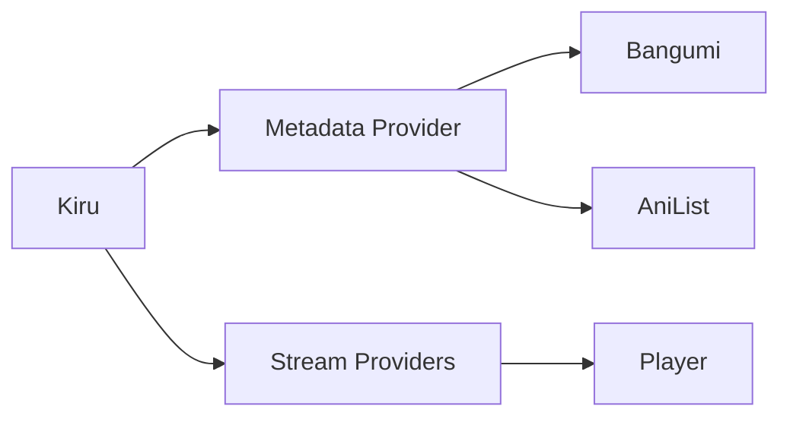

<div align="center">


<h1>Kiru</h1>

<p><code>ANIME / CINEMA / MUSIC / BEYOND</code></p>

<p><b>连接次元，探索光影。</b><br/>
<sub>物語の続きを、ここから。 — Your next story begins here.</sub></p>

<a href="LICENSE"></a>


<p><a href="#功能">功能</a> · <a href="#数据源">数据源</a> · <a href="#运行">运行</a> · <a href="#鸣谢">鸣谢</a></p>

</div>

---

**Kiru** 是一款基于 Flutter 的开源多媒体客户端，以中文体验与可扩展数据源为核心，将番剧、影视、音乐和阅读融入同一个数字空间。

无需注册 Kiru 账户，自由探索作品，在属于自己的节奏里继续每一段故事。

## 功能

<sub>01 / FEATURES</sub>

| 模块 | 能力 |
| :--- | :--- |
| 🌸 **Anime · 动漫** | 中文番剧信息、季度目录、搜索与选集 |
| 🎬 **Cinema · 影视** | 电影、剧集、精选合集与多源播放 |
| 🎧 **Music · 音乐** | 音乐搜索、专辑、歌单与迷你播放器 |
| 📖 **Reading · 阅读** | 漫画、电子书与有声书 |
| 📡 **Live · 直播** | IPTV 播放列表与频道管理 |
| ◈ **Library · 媒体库** | 收藏、观看历史与续播 |

**Playback** — media_kit / libmpv · 硬件解码 · Anime4K · 字幕与音轨 · 4K / HDR（视片源及设备而定）

## 数据源

<sub>02 / MODULAR SOURCES</sub>



Bangumi / AniList 可在设置中切换，支持中文元数据、离线名称索引、缓存、自动回退、自定义镜像及代理。元数据与播放源独立管理。

现阶段 Bangumi 目录仅展示能够可靠映射至 AniList ID 的作品。

[数据源实现说明 →](docs/product-development/ANIME_DATA_SOURCES.md)

## 运行

<sub>03 / QUICK START</sub>

技术栈：**Flutter · Dart · media_kit · libmpv · ARB**

安装 Flutter（Dart SDK 满足 `^3.11.5`）及 Windows C++ 桌面开发工具，在项目根目录执行：

```bash
flutter pub get
flutter gen-l10n
flutter run -d windows
```

当前为开发版本，Windows Debug 已验证；其他平台及独立 Release 安装包尚未验收。部分继承模块及第三方服务的实际可用性仍需验证。

## 鸣谢

<sub>04 / CREDITS & LICENSE</sub>

Kiru 基于 [ZPlay](https://github.com/tzero86/ZPlay) 开发，其上游为 [PlayTorrio V3](https://github.com/ayman708-UX/PlayTorrioV3)（© 2026 Ayman）。动漫数据接入参考 [Kazumi](https://github.com/Predidit/Kazumi)。

感谢 [Bangumi](https://bgm.tv/)、[AniList](https://anilist.co/)、[bangumi-data](https://github.com/bangumi-data/bangumi-data)、[media_kit](https://github.com/media-kit/media-kit)、[mpv](https://mpv.io/) 与 [TMDB](https://www.themoviedb.org/)。

项目采用 [GPL-3.0](LICENSE)；中文动漫索引采用 [CC BY 4.0](assets/metadata/BANGUMI_DATA_NOTICE.txt)，Poppins 字体采用 SIL OFL 1.1。第三方依赖遵循各自许可证。本产品使用 TMDB API，但未获得 TMDB 认可或认证。

Kiru 不提供自营影视内容服务；第三方来源可能需要账户、密钥或订阅，P2P 播放可能上传数据。请仅访问和分享具有合法授权的内容。

---

<div align="center">

<sub>また、次の物語で。</sub>

<b>SEE YOU IN THE NEXT STORY.</b>

</div>
