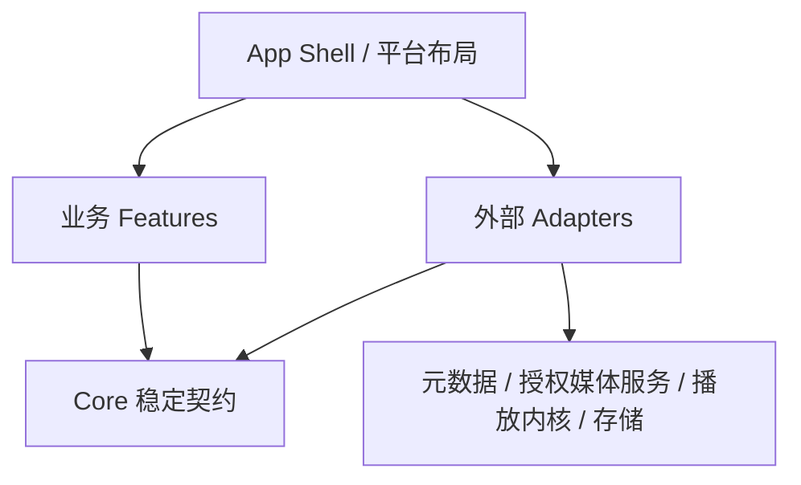

# 系统架构与演进方案
## 1. 架构原则
外部适配独立，内部按业务聚合；依赖方向向稳定契约收敛。仅在存在明确变更场景时提取公共层，不引入空目录、空接口或统一模板式分包。
现有 Shell、MaterialApp、生命周期、主题、焦点管理、播放器与数据存储优先复用。目标架构是渐进演进，不是要求首轮搬迁全部文件。
## 2. 逻辑结构

App 负责装配；Feature 负责页面、状态、用例；Core 定义媒体、播放、来源与存储契约；Adapter 实现外部依赖；Shared 仅放跨模块真实复用 UI 与无业务工具。Feature 不导入具体外部服务实现；Core 不依赖 Flutter UI 和具体第三方 SDK。
## 3. 目标目录（按需创建）
```text
lib/
  main.dart
  shell/                 # 保留现有全局导航
  app/                   # 初始化、装配、配置（逐步提取）
  features/
    discover/            # 首页、浏览、搜索共享影视发现逻辑
    details/             # 详情、选集
    anime/               # 动漫专属功能
    sources/             # 源展示、配置、排序
    player/              # 会话、控制、播放 UI
    library/             # 收藏、历史、媒体库
    settings/
  core/
    media/               # 统一媒体身份与元数据契约
    sources/             # SourceProvider、查询、取消
    playback/            # 播放会话、能力、事件
    storage/             # 持久化契约
  adapters/
    metadata/            # TMDB / Bangumi 等
    sources/             # Stremio / 用户授权 HTTP
    engines/             # media_kit / Media3
    media_servers/       # WebDAV / SMB / Jellyfin
    persistence/
  shared/                # 主题 token、公共组件等
  l10n/                  # 保留现有生成机制
  models/ pages/ services/ widgets/ utils/ # 迁移期原位置
```
禁止同时维护两套相同业务实现；迁移期间由旧入口委托新用例。只在所有引用和测试迁移完成后删除旧文件。简单功能无需人为拆成 controller/domain/repository 多层。
## 4. 稳定接口与核心数据契约（目标草案，不是现有 API）
| 契约 | 关键字段/行为 |
|---|---|
| MediaIdentity | type、namespace、id、externalIds；不以标题为唯一键 |
| EpisodeIdentity | mediaId、season、episode、providerEpisodeId；特殊集/动漫绝对集数映射显式处理 |
| MediaMetadata | title、originalTitle、year、artwork、overview、locale、updatedAt、provenance |
| SourceQuery | media/episode identity、locale、偏好、请求 ID、超时与取消上下文 |
| SourceCandidate | providerId、candidateId、transport、声明分辨率、编码、HDR、音轨、文件大小、有效期；未知可空 |
| ResolvedStream | URI、必要 headers、有效期、字幕轨、鉴权引用；仅会话内使用，不记录敏感值 |
| SourceProvider | capabilities、discover、resolve、cancel/dispose；单源故障不拖累其他来源 |
| PlaybackSession | sessionId、mediaId、episodeId、sourceId、position、duration、state、actualMediaInfo |
| PlayerEngine | open/play/pause/seek/dispose、事件流、设备能力；优先适配现有 VideoEngine |
| ProgressRepository | save/load/list；按媒体与集数去重、记录实际观看位置 |
## 5. 主流程与并发控制
详情 → SourceQuery → 注册表选择已启用且支持类型的 provider → 并发查询（限流、独立超时、取消）→ 候选流逐步展示 → 标准化/去重/排序 → 用户选择 → resolve → 引擎选择 → 播放 → 实际信息更新 → 进度持久化。
每次选集/离页产生独立请求作用域，废弃结果不得更新新页面。去重以来源和资源身份为主，不能把不同清晰度误合并。排序优先可播放/用户偏好/设备兼容，不能以未验证文件名判定真实画质。失效 URL 播放时重新解析；不持久化带令牌的 URI。健康检测限制请求并发、超时和响应体大小；不对外部源进行无节制探测。
## 6. 存储与安全
先保留现有 SharedPreferences、JSON Document Store、SecureStore；根据容量、查询需求和数据一致性证据决定是否引入 Drift/SQLite。
拟持久化实体：media_items、external_ids、episodes、watch_progress、favorites、source_configs、media_servers、local_file_index、download_tasks。唯一键含来源命名空间及集数；进度按会话节流写入，退出/暂停时刷新；数据库迁移可回退并有备份；敏感令牌仅通过平台安全存储，不明文入库/日志/导出。
外部 URL 仅允许符合协议和用户授权的来源；限制扩展访问范围，明确用户添加 NAS 的局域网访问与普通公共源的权限差异；防止未知插件任意访问本地服务或文件。更新包须由独立可信发布渠道提供，验证完整性与签名能力。
## 7. 实施顺序
先梳理 Shell / Browse / WatchScreen / StreamService 的真实调用链并建立测试；提取源查询控制器和 Provider registry；其次提取播放会话与 UI；最后在确有需求时迁移媒体库持久化。每一阶段保留可运行基线并执行回归。
